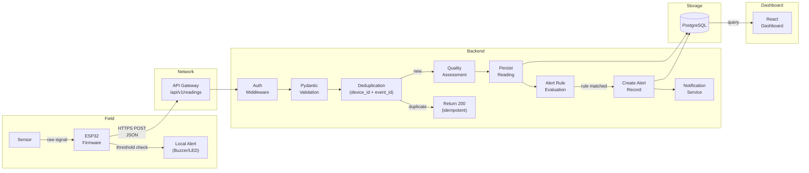
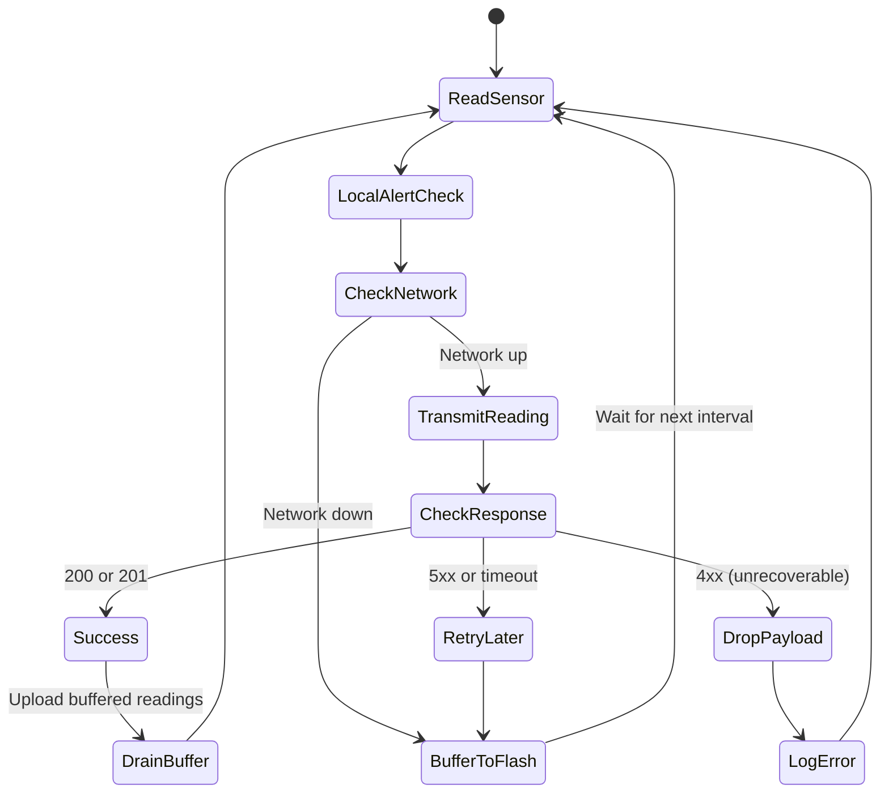
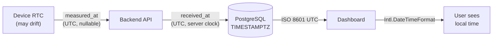

# HeatShield Bharat — Data Flow Specification

> **Status:** Proposed (Module 2). Subject to refinement during implementation.

---

## 1. End-to-End Data Flow



---

## 2. Flow Steps in Detail

### Step 1: Sensor Reading

- The sensor produces a raw analog or digital signal.
- The ESP32 reads this signal at a configurable interval.
- The firmware converts the raw signal to engineering units (°C, %RH).
- The firmware assigns a monotonically increasing `event_id` for this device.
- The firmware records `measured_at` from the device's RTC (nullable if clock is unreliable).

### Step 2: Local Alert Check

- The firmware computes a local heat-index or applies simple threshold logic.
- If a local threshold is exceeded, the buzzer and/or LED are activated immediately.
- This step is **independent of network connectivity**.

### Step 3: Telemetry Transmission

The firmware constructs a JSON payload:

```json
{
  "device_code": "HS-WS01-D001",
  "event_id": "evt-00042",
  "measured_at": "2026-11-15T10:30:00Z",
  "temperature_c": 38.5,
  "relative_humidity_pct": 72.3,
  "firmware_version": "0.1.0"
}
```

> ⚠ **Illustrative values only.** These are not actual hardware readings.

- Transmitted via HTTPS POST to `/api/v1/readings`.
- Includes a device authentication header (mechanism TBD).
- If the network is unavailable, the reading is buffered in flash storage.

### Step 4: Authentication

- The backend middleware validates the device authentication token.
- Rejected requests return `401 Unauthorized` without persisting data.

### Step 5: Validation

- Pydantic schema validates the JSON payload structure, types, and constraints.
- `temperature_c`: nullable numeric (no invented safe-range constraints).
- `relative_humidity_pct`: nullable numeric, must be 0–100 if present.
- `event_id`: required, string.
- `device_code`: required, must match a registered device.
- Validation failures return `422 Unprocessable Entity` with field-level errors.

### Step 6: Deduplication

- The backend checks the unique constraint `(device_id, event_id)`.
- If a reading with the same device and event_id already exists, the request returns `200 OK` with the existing reading — **idempotent**.
- This enables safe retries from the firmware without creating duplicates.

### Step 7: Quality Assessment

The backend assigns a `quality_status` based on the received data:

| Status | Meaning |
|---|---|
| `valid` | All expected fields present, within plausible physical ranges |
| `suspect` | Values present but outside expected environmental ranges (e.g., 80°C) |
| `invalid` | Payload structurally valid but values indicate sensor error (e.g., NaN-equivalent) |
| `missing` | Expected measurement fields are null |

- The quality assessment does **not** discard readings — all are persisted.
- Only `valid` readings are evaluated by the alert engine.
- Quality boundaries are **not** medical or sensor-specification thresholds — they are broad plausibility checks.

### Step 8: Persistence

- The validated reading is inserted into `sensor_readings` with:
  - `received_at` = server timestamp (UTC, always set by the server).
  - `measured_at` = device-provided timestamp (UTC, nullable).
  - `quality_status` = result of quality assessment.
  - `source_mode` = `hardware` (or `simulated` for dev seed data).

### Step 9: Alert Rule Evaluation

- The alert engine queries enabled alert rules applicable to the device's worksite.
- Each rule specifies a metric, comparison operator, threshold, and severity.
- Rules are evaluated against the **current reading** and, for sustained-condition rules, recent reading history.
- Matched rules produce alert records referencing the rule ID and `rule_version`.

### Step 10: Alert Record & Notification

- A new alert record is created with status `triggered`.
- The notification service delivers alerts via configured channels (TBD: dashboard push, email, webhook).
- Alert lifecycle: `triggered` → `acknowledged` → `resolved` or `expired`.

### Step 11: Dashboard Query

- The React dashboard queries the backend REST API for:
  - Latest readings per device.
  - Historical readings with time-range and pagination.
  - Active and historical alerts.
  - Device and worksite metadata.
- All timestamps are returned in ISO 8601 UTC format.
- The frontend converts to local display time in the browser.

---

## 3. Offline Buffering & Retry Flow



**Retry policy (firmware-side):**
- On `5xx` or timeout: buffer locally, retry on next cycle.
- On `200`: reading accepted (possibly deduplicated).
- On `201`: new reading created.
- On `401`: authentication failure — log error, do not retry until reconfigured.
- On `422`: validation failure — log error, do not retry (payload is malformed).

---

## 4. Timestamp Handling



| Timestamp | Set By | Purpose | Nullable |
|---|---|---|---|
| `measured_at` | Device | When the sensor was actually read | Yes (device clock may be unreliable) |
| `received_at` | Server | When the backend received the data | No (always set) |
| `created_at` | Server | Row insertion time (= `received_at` for readings) | No |

- PostgreSQL column type: `TIMESTAMP WITH TIME ZONE`.
- Application code always passes timezone-aware UTC values.
- The frontend is responsible for local-time display conversion.

---

## 5. Missing & Invalid Data Handling

| Scenario | Firmware Behaviour | Backend Behaviour |
|---|---|---|
| Sensor returns no data | Set `temperature_c` / `humidity` to `null` | `quality_status` = `missing`, reading persisted |
| Sensor returns implausible value | Include raw value in payload | `quality_status` = `suspect` or `invalid`, reading persisted |
| Device clock unavailable | Set `measured_at` to `null` | Accept; `received_at` provides temporal ordering |
| Duplicate `event_id` | Normal retry behaviour | Return existing reading (idempotent `200`) |
| Unknown `device_code` | — | Return `422` with error detail |

Invalid and missing readings are **always persisted** for diagnostic purposes
but are excluded from alert evaluation and risk calculation.

---

## 6. Cross-References

- [System Architecture](system-architecture.md)
- [Database Design](database-design.md)
- [API Contracts](api-contracts.md)
- [Architecture Decisions](../decisions/architecture-decisions.md)
