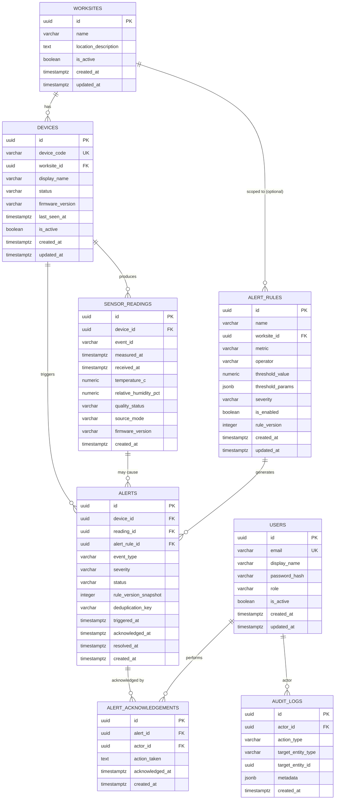
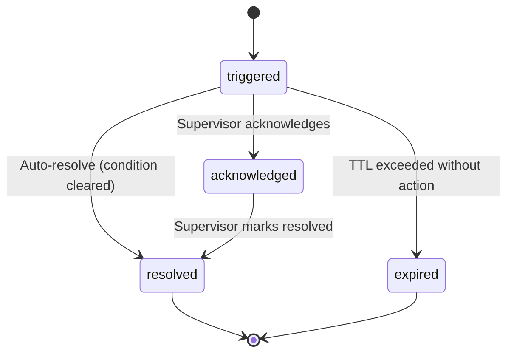

# HeatShield Bharat — Database Design

> **Status:** Proposed logical design (Module 2). No tables, SQLAlchemy models,
> or Alembic migrations have been created yet. Implementation is planned for
> Module 3.
>
> All column types reference PostgreSQL conventions. SQLAlchemy model
> definitions will mirror this specification.

---

## 1. Entity-Relationship Diagram

---

## 2. Entity Specifications

### 2.1 Worksites

Represents a monitored physical site (e.g., a construction site, factory floor,
outdoor work area).

| Column | Type | Nullable | Default | Constraints | Notes |
|---|---|---|---|---|---|
| `id` | `UUID` | No | `gen_random_uuid()` | `PRIMARY KEY` | |
| `name` | `VARCHAR(200)` | No | — | `NOT NULL` | Human-readable site name |
| `location_description` | `TEXT` | Yes | `NULL` | — | Free-text description (e.g., "Building C, North Wing") |
| `is_active` | `BOOLEAN` | No | `TRUE` | `NOT NULL` | Soft deletion flag |
| `created_at` | `TIMESTAMPTZ` | No | `NOW()` | `NOT NULL` | Row creation time (UTC) |
| `updated_at` | `TIMESTAMPTZ` | No | `NOW()` | `NOT NULL` | Last modification time (UTC) |

**Design notes:**
- No latitude/longitude columns — precise geolocation is not required for the
  initial scope. If needed later, add as a separate migration.
- Deactivated worksites (`is_active = FALSE`) retain all historical data.

---

### 2.2 Devices

Represents an ESP32 sensor node registered with the system.

| Column | Type | Nullable | Default | Constraints | Notes |
|---|---|---|---|---|---|
| `id` | `UUID` | No | `gen_random_uuid()` | `PRIMARY KEY` | |
| `device_code` | `VARCHAR(100)` | No | — | `UNIQUE`, `NOT NULL` | Stable, non-secret identifier (e.g., `HS-WS01-D001`) |
| `worksite_id` | `UUID` | No | — | `FOREIGN KEY → worksites(id)`, `NOT NULL` | Assigned worksite |
| `display_name` | `VARCHAR(200)` | Yes | `NULL` | — | Optional human-friendly name |
| `status` | `VARCHAR(20)` | No | `'registered'` | `NOT NULL`, `CHECK` | See device status values below |
| `firmware_version` | `VARCHAR(50)` | Yes | `NULL` | — | Last reported firmware version |
| `last_seen_at` | `TIMESTAMPTZ` | Yes | `NULL` | — | Updated on each telemetry receipt |
| `is_active` | `BOOLEAN` | No | `TRUE` | `NOT NULL` | Soft deletion flag |
| `created_at` | `TIMESTAMPTZ` | No | `NOW()` | `NOT NULL` | |
| `updated_at` | `TIMESTAMPTZ` | No | `NOW()` | `NOT NULL` | |

**Device status values:**

| Value | Meaning |
|---|---|
| `registered` | Device created but has never reported telemetry |
| `online` | Device has reported telemetry recently (within expected interval) |
| `offline` | Device has not reported within the expected interval |
| `deactivated` | Device removed from active monitoring |

**Indexes:**
- `UNIQUE INDEX` on `device_code`.
- `INDEX` on `worksite_id` (for worksite-scoped device queries).
- `INDEX` on `status` (for filtering active/online devices).

**Deletion behaviour:**
- Deactivating a device sets `is_active = FALSE` and `status = 'deactivated'`.
- Historical readings and alerts are preserved.
- The `worksite_id` foreign key does **not** cascade deletes — worksites must
  be deactivated, not deleted.

**Security note:**
Device authentication secrets (API keys, tokens) are **never** stored in this
table. A separate credentials store or environment-based configuration will be
used (mechanism TBD).

---

### 2.3 Sensor Readings

Stores individual environmental measurements from devices.

| Column | Type | Nullable | Default | Constraints | Notes |
|---|---|---|---|---|---|
| `id` | `UUID` | No | `gen_random_uuid()` | `PRIMARY KEY` | |
| `device_id` | `UUID` | No | — | `FOREIGN KEY → devices(id)`, `NOT NULL` | Reporting device |
| `event_id` | `VARCHAR(100)` | No | — | `NOT NULL` | Device-assigned per-event identifier |
| `measured_at` | `TIMESTAMPTZ` | Yes | `NULL` | — | Device clock at measurement time (UTC); nullable if clock is unreliable |
| `received_at` | `TIMESTAMPTZ` | No | `NOW()` | `NOT NULL` | Server clock at receipt time (UTC); always set by server |
| `temperature_c` | `NUMERIC(6,2)` | Yes | `NULL` | — | Temperature in degrees Celsius |
| `relative_humidity_pct` | `NUMERIC(5,2)` | Yes | `NULL` | `CHECK (relative_humidity_pct IS NULL OR (relative_humidity_pct >= 0 AND relative_humidity_pct <= 100))` | Relative humidity in percent |
| `quality_status` | `VARCHAR(20)` | No | `'valid'` | `NOT NULL`, `CHECK` | See quality status values below |
| `source_mode` | `VARCHAR(20)` | No | `'hardware'` | `NOT NULL`, `CHECK` | See source mode values below |
| `firmware_version` | `VARCHAR(50)` | Yes | `NULL` | — | Firmware version at time of reading |
| `created_at` | `TIMESTAMPTZ` | No | `NOW()` | `NOT NULL` | Row insertion time |

**Quality status values:**

| Value | Meaning |
|---|---|
| `valid` | All expected fields present and within plausible physical ranges |
| `suspect` | Values present but outside expected environmental ranges |
| `invalid` | Payload structurally valid but values indicate sensor error |
| `missing` | Expected measurement fields are null |

Quality boundaries are broad plausibility checks, **not** medical thresholds
or sensor specification limits. They are not claimed to comply with any
official standard.

**Source mode values:**

| Value | Meaning |
|---|---|
| `hardware` | Reading from a physical sensor |
| `simulated` | Reading generated by development/test tooling — clearly labelled |

**Constraints:**
- `UNIQUE (device_id, event_id)` — prevents duplicate ingestion; enables idempotent retries.
- `relative_humidity_pct` CHECK: 0–100 when not null.
- Invalid or missing readings are persisted (never silently discarded) but
  `quality_status` identifies them for downstream filtering.

**Indexes:**
- `UNIQUE INDEX` on `(device_id, event_id)` — deduplication.
- `INDEX` on `(device_id, received_at DESC)` — latest-reading queries.
- `INDEX` on `(device_id, measured_at DESC)` — time-range history queries.
- `INDEX` on `quality_status` — filtering valid readings for alert evaluation.

**Timestamp representation:**
All `TIMESTAMPTZ` columns store timezone-aware UTC values. See
[ADR-009](../decisions/architecture-decisions.md) for the full rationale.

---

### 2.4 Alert Rules

Represents configurable alert conditions evaluated by the backend alert engine.

| Column | Type | Nullable | Default | Constraints | Notes |
|---|---|---|---|---|---|
| `id` | `UUID` | No | `gen_random_uuid()` | `PRIMARY KEY` | |
| `name` | `VARCHAR(200)` | No | — | `NOT NULL` | Human-readable rule name |
| `worksite_id` | `UUID` | Yes | `NULL` | `FOREIGN KEY → worksites(id)` | Scope to a specific worksite; `NULL` = global default |
| `metric` | `VARCHAR(50)` | No | — | `NOT NULL` | Metric identifier (e.g., `temperature_c`, `relative_humidity_pct`, `heat_index`) |
| `operator` | `VARCHAR(10)` | No | — | `NOT NULL`, `CHECK` | Comparison operator |
| `threshold_value` | `NUMERIC(10,2)` | Yes | `NULL` | — | Simple threshold for single-value comparisons |
| `threshold_params` | `JSONB` | Yes | `NULL` | — | Extended parameters for complex rules (e.g., sustained duration, moving average) |
| `severity` | `VARCHAR(20)` | No | — | `NOT NULL`, `CHECK` | See severity values below |
| `is_enabled` | `BOOLEAN` | No | `TRUE` | `NOT NULL` | Toggle rule on/off without deleting |
| `rule_version` | `INTEGER` | No | `1` | `NOT NULL` | Incremented on each rule modification |
| `created_at` | `TIMESTAMPTZ` | No | `NOW()` | `NOT NULL` | |
| `updated_at` | `TIMESTAMPTZ` | No | `NOW()` | `NOT NULL` | |

**Comparison operators:**

| Value | Meaning |
|---|---|
| `gt` | Greater than |
| `gte` | Greater than or equal |
| `lt` | Less than |
| `lte` | Less than or equal |
| `eq` | Equal |

**Severity values** (shared with alerts):

| Value | Meaning |
|---|---|
| `info` | Informational condition |
| `warning` | Elevated risk — attention advised |
| `critical` | High risk — immediate action recommended |
| `emergency` | Extreme risk — urgent intervention required |

These severity levels are **operational categories**, not medical diagnoses.
They do not claim to comply with any specific occupational health standard.
Appropriate thresholds must be determined with relevant domain guidance.

**Rule versioning:**
- `rule_version` starts at 1 and is incremented each time the rule is updated.
- When an alert is generated, the current `rule_version` is snapshot into the
  `alerts.rule_version_snapshot` column.
- This allows post-hoc auditing of which rule configuration produced a given alert.
- Old rule configurations are not separately archived in the initial design.
  If full rule history is needed, a `rule_history` table can be added later.

**Indexes:**
- `INDEX` on `worksite_id` (for worksite-scoped rule queries).
- `INDEX` on `is_enabled` (for filtering active rules).

---

### 2.5 Alerts

Stores alert events generated by the alert engine or reported by devices.

| Column | Type | Nullable | Default | Constraints | Notes |
|---|---|---|---|---|---|
| `id` | `UUID` | No | `gen_random_uuid()` | `PRIMARY KEY` | |
| `device_id` | `UUID` | No | — | `FOREIGN KEY → devices(id)`, `NOT NULL` | Device that produced the triggering reading |
| `reading_id` | `UUID` | Yes | `NULL` | `FOREIGN KEY → sensor_readings(id)` | Specific reading that triggered the alert (nullable for multi-reading rules) |
| `alert_rule_id` | `UUID` | Yes | `NULL` | `FOREIGN KEY → alert_rules(id)` | Rule that generated the alert (nullable for device-reported alerts) |
| `event_type` | `VARCHAR(50)` | No | — | `NOT NULL` | Alert category (e.g., `threshold_exceeded`, `device_offline`, `sensor_error`) |
| `severity` | `VARCHAR(20)` | No | — | `NOT NULL`, `CHECK` | Same severity values as alert rules |
| `status` | `VARCHAR(20)` | No | `'triggered'` | `NOT NULL`, `CHECK` | See alert status values and transitions below |
| `rule_version_snapshot` | `INTEGER` | Yes | `NULL` | — | Rule version at the time the alert was generated |
| `deduplication_key` | `VARCHAR(200)` | Yes | `NULL` | — | Optional key to prevent duplicate alerts for the same sustained condition |
| `triggered_at` | `TIMESTAMPTZ` | No | `NOW()` | `NOT NULL` | When the alert was triggered |
| `acknowledged_at` | `TIMESTAMPTZ` | Yes | `NULL` | — | When the alert was first acknowledged |
| `resolved_at` | `TIMESTAMPTZ` | Yes | `NULL` | — | When the alert was resolved or expired |
| `created_at` | `TIMESTAMPTZ` | No | `NOW()` | `NOT NULL` | Row insertion time |

**Alert status values and transitions:**

| Status | Meaning |
|---|---|
| `triggered` | Alert generated, no action taken yet |
| `acknowledged` | A supervisor has seen and acknowledged the alert |
| `resolved` | The alert condition has been addressed or cleared |
| `expired` | The alert was not acknowledged within a configured time window |

**Important distinction — severity vs. status:**
- **Severity** describes *how serious* the condition is (`info`, `warning`, `critical`, `emergency`).
- **Status** describes *where the alert is in its lifecycle* (`triggered`, `acknowledged`, `resolved`, `expired`).
- These are independent dimensions. A `critical` alert can be `acknowledged` while a `warning` alert can still be `triggered`.

**Deduplication:**
- The `deduplication_key` prevents the alert engine from creating multiple
  alerts for the same sustained condition (e.g., temperature continuously
  above threshold across many consecutive readings).
- Format: `{device_id}:{event_type}:{metric}:{rule_id}` (suggested, not enforced by DB).
- The alert engine checks for an active (non-resolved, non-expired) alert with
  the same deduplication key before creating a new one.

**Indexes:**
- `INDEX` on `device_id` (device alert history).
- `INDEX` on `status` (active alert queries).
- `INDEX` on `(device_id, status)` (active alerts per device).
- `INDEX` on `triggered_at DESC` (recent alerts).
- `INDEX` on `deduplication_key` (dedup lookups).

---

### 2.6 Alert Acknowledgements

Records individual acknowledgement actions and associated safety responses.

| Column | Type | Nullable | Default | Constraints | Notes |
|---|---|---|---|---|---|
| `id` | `UUID` | No | `gen_random_uuid()` | `PRIMARY KEY` | |
| `alert_id` | `UUID` | No | — | `FOREIGN KEY → alerts(id)`, `NOT NULL` | Acknowledged alert |
| `actor_id` | `UUID` | Yes | `NULL` | `FOREIGN KEY → users(id)` | Nullable until user authentication is implemented |
| `action_taken` | `TEXT` | Yes | `NULL` | — | Optional free-text description of the safety action |
| `acknowledged_at` | `TIMESTAMPTZ` | No | `NOW()` | `NOT NULL` | When this acknowledgement was made |
| `created_at` | `TIMESTAMPTZ` | No | `NOW()` | `NOT NULL` | Row insertion time |

**Design rationale — why a separate table?**

The `alerts` table has `acknowledged_at` for the *first* acknowledgement
timestamp (denormalised for fast queries). The `alert_acknowledgements` table
captures:
- Multiple acknowledgement actions on the same alert (e.g., shift handover).
- The actor who acknowledged.
- The safety action taken.
- An audit trail.

If only a single acknowledgement per alert is ever needed, the
`alert_acknowledgements` table can be omitted and the `alerts.acknowledged_at`
field is sufficient. The separate table is included because:
1. Alerts may span shift changes, requiring multiple actors to acknowledge.
2. The `action_taken` field provides documented evidence of safety response.
3. Audit requirements benefit from a dedicated record.

**Indexes:**
- `INDEX` on `alert_id` (acknowledgements for a specific alert).
- `INDEX` on `actor_id` (acknowledgements by a specific user).

---

### 2.7 Users

Represents application accounts for the supervisor dashboard. Authentication
implementation is deferred to a later module.

| Column | Type | Nullable | Default | Constraints | Notes |
|---|---|---|---|---|---|
| `id` | `UUID` | No | `gen_random_uuid()` | `PRIMARY KEY` | |
| `email` | `VARCHAR(255)` | No | — | `UNIQUE`, `NOT NULL` | Login identifier |
| `display_name` | `VARCHAR(200)` | Yes | `NULL` | — | |
| `password_hash` | `VARCHAR(255)` | No | — | `NOT NULL` | Bcrypt or Argon2 hash — **never plaintext** |
| `role` | `VARCHAR(20)` | No | `'viewer'` | `NOT NULL`, `CHECK` | See role values below |
| `is_active` | `BOOLEAN` | No | `TRUE` | `NOT NULL` | Soft deletion flag |
| `created_at` | `TIMESTAMPTZ` | No | `NOW()` | `NOT NULL` | |
| `updated_at` | `TIMESTAMPTZ` | No | `NOW()` | `NOT NULL` | |

**Role values:**

| Value | Meaning |
|---|---|
| `viewer` | Read-only dashboard access |
| `supervisor` | Can acknowledge alerts, manage devices |
| `admin` | Full access including user management, rule configuration |

**Future considerations:**
- If site-level permissions are needed, a `user_worksite_roles` join table
  can be added without modifying the `users` table.
- OAuth/SSO integration would add columns or a separate `auth_providers` table.

**Indexes:**
- `UNIQUE INDEX` on `email`.
- `INDEX` on `role` (for role-based filtering).

---

### 2.8 Audit Logs

Records security-relevant and administrative actions for accountability.

| Column | Type | Nullable | Default | Constraints | Notes |
|---|---|---|---|---|---|
| `id` | `UUID` | No | `gen_random_uuid()` | `PRIMARY KEY` | |
| `actor_id` | `UUID` | Yes | `NULL` | `FOREIGN KEY → users(id)` | Nullable for system-generated events |
| `action_type` | `VARCHAR(50)` | No | — | `NOT NULL` | See action types below |
| `target_entity_type` | `VARCHAR(50)` | Yes | `NULL` | — | Entity type affected (e.g., `device`, `alert_rule`, `user`) |
| `target_entity_id` | `UUID` | Yes | `NULL` | — | Entity ID affected |
| `metadata` | `JSONB` | Yes | `NULL` | — | Minimal, non-sensitive contextual data |
| `created_at` | `TIMESTAMPTZ` | No | `NOW()` | `NOT NULL` | Event timestamp |

**Action types (initial set):**

| Value | Description |
|---|---|
| `device.register` | New device registered |
| `device.deactivate` | Device deactivated |
| `alert_rule.create` | Alert rule created |
| `alert_rule.update` | Alert rule modified |
| `alert_rule.disable` | Alert rule disabled |
| `alert.acknowledge` | Alert acknowledged |
| `alert.resolve` | Alert resolved |
| `user.create` | User account created |
| `user.deactivate` | User account deactivated |
| `user.role_change` | User role modified |

**Security constraints:**
- **Never log:** passwords, password hashes, device secrets, API keys, tokens.
- **Never log:** unnecessary personal or physiological data.
- The `metadata` JSONB field contains only operational context (e.g., "old_role",
  "new_role" for a role change — never the password itself).
- Audit log rows are **append-only** — they should never be updated or deleted
  in normal operation.

**Indexes:**
- `INDEX` on `actor_id` (actions by a specific user).
- `INDEX` on `(target_entity_type, target_entity_id)` (actions on a specific entity).
- `INDEX` on `created_at DESC` (recent actions).
- `INDEX` on `action_type` (filtering by action category).

---

## 3. Relationships Summary

| Relationship | Type | FK Column | ON DELETE | Notes |
|---|---|---|---|---|
| Worksite → Devices | One-to-many | `devices.worksite_id` | `RESTRICT` | Cannot delete worksite with devices |
| Worksite → Alert Rules | One-to-many (optional) | `alert_rules.worksite_id` | `SET NULL` | Rule becomes global if worksite removed |
| Device → Sensor Readings | One-to-many | `sensor_readings.device_id` | `RESTRICT` | Cannot delete device with readings |
| Device → Alerts | One-to-many | `alerts.device_id` | `RESTRICT` | Cannot delete device with alerts |
| Sensor Reading → Alerts | One-to-many (optional) | `alerts.reading_id` | `SET NULL` | Alert preserved if reading is removed |
| Alert Rule → Alerts | One-to-many (optional) | `alerts.alert_rule_id` | `SET NULL` | Alert preserved if rule is removed |
| Alert → Acknowledgements | One-to-many | `alert_acknowledgements.alert_id` | `CASCADE` | Acknowledgements deleted with alert |
| User → Acknowledgements | One-to-many (optional) | `alert_acknowledgements.actor_id` | `SET NULL` | Acknowledgement preserved if user removed |
| User → Audit Logs | One-to-many (optional) | `audit_logs.actor_id` | `SET NULL` | Log preserved if user removed |

**Deletion philosophy:**
- **RESTRICT** on devices and worksites prevents accidental data loss.
- **Soft deletion** (`is_active = FALSE`) is the preferred deactivation mechanism.
- Hard deletion is reserved for GDPR/compliance scenarios and requires
  explicit administrative action.
- Historical sensor readings, alerts, and audit logs are **never** automatically
  cascade-deleted through foreign key constraints in normal operation.

---

## 4. Index Summary

| Table | Index | Columns | Type | Purpose |
|---|---|---|---|---|
| `devices` | `uq_devices_device_code` | `device_code` | UNIQUE | Device lookup |
| `devices` | `ix_devices_worksite_id` | `worksite_id` | B-tree | Worksite device listing |
| `devices` | `ix_devices_status` | `status` | B-tree | Status filtering |
| `sensor_readings` | `uq_readings_device_event` | `(device_id, event_id)` | UNIQUE | Deduplication |
| `sensor_readings` | `ix_readings_device_received` | `(device_id, received_at DESC)` | B-tree | Latest reading queries |
| `sensor_readings` | `ix_readings_device_measured` | `(device_id, measured_at DESC)` | B-tree | Time-range history |
| `sensor_readings` | `ix_readings_quality` | `quality_status` | B-tree | Valid reading filtering |
| `alert_rules` | `ix_alert_rules_worksite` | `worksite_id` | B-tree | Worksite rule lookup |
| `alert_rules` | `ix_alert_rules_enabled` | `is_enabled` | B-tree | Active rule filtering |
| `alerts` | `ix_alerts_device` | `device_id` | B-tree | Device alert history |
| `alerts` | `ix_alerts_status` | `status` | B-tree | Active alert queries |
| `alerts` | `ix_alerts_device_status` | `(device_id, status)` | B-tree | Active alerts per device |
| `alerts` | `ix_alerts_triggered` | `triggered_at DESC` | B-tree | Recent alerts |
| `alerts` | `ix_alerts_dedup` | `deduplication_key` | B-tree | Dedup lookups |
| `alert_acknowledgements` | `ix_ack_alert` | `alert_id` | B-tree | Alert acknowledgements |
| `alert_acknowledgements` | `ix_ack_actor` | `actor_id` | B-tree | User acknowledgements |
| `users` | `uq_users_email` | `email` | UNIQUE | Login lookup |
| `users` | `ix_users_role` | `role` | B-tree | Role filtering |
| `audit_logs` | `ix_audit_actor` | `actor_id` | B-tree | User action history |
| `audit_logs` | `ix_audit_target` | `(target_entity_type, target_entity_id)` | B-tree | Entity action history |
| `audit_logs` | `ix_audit_created` | `created_at DESC` | B-tree | Recent actions |
| `audit_logs` | `ix_audit_action` | `action_type` | B-tree | Action filtering |

Indexes will be created in the Alembic migration (Module 3). The list above
avoids unnecessary indexes — each one serves a documented query pattern.

---

## 5. Timestamp Convention

All timestamp columns use PostgreSQL `TIMESTAMP WITH TIME ZONE` (`TIMESTAMPTZ`).

| Principle | Rule |
|---|---|
| Storage | UTC always |
| Application code | Pass timezone-aware `datetime` objects with `tzinfo=UTC` |
| API responses | ISO 8601 format with `Z` suffix (e.g., `2026-11-15T10:30:00Z`) |
| Frontend display | Convert to user's local timezone using `Intl.DateTimeFormat` |
| Device timestamps | Accept as UTC; nullable if device clock is unreliable |
| Server timestamps | Always generated by the server; never trust device for `received_at` |

See [ADR-009](../decisions/architecture-decisions.md) for the full rationale.

---

## 6. Data Retention & Archival (Future)

No retention policy is enforced in the initial implementation. Considerations
for later modules:

- **Sensor readings:** May accumulate rapidly. Consider time-based partitioning
  or the TimescaleDB extension if volume exceeds performance targets.
- **Alerts:** Retain indefinitely for audit purposes.
- **Audit logs:** Retain indefinitely; append-only.
- **Deactivated entities:** Preserved with `is_active = FALSE`.

---

## 7. Cross-References

- [System Architecture](system-architecture.md)
- [Data Flow Specification](data-flow.md)
- [API Contracts](api-contracts.md)
- [Architecture Decisions](../decisions/architecture-decisions.md)
- [Schema Notes (Module 1)](../../database/schema-notes.md)
