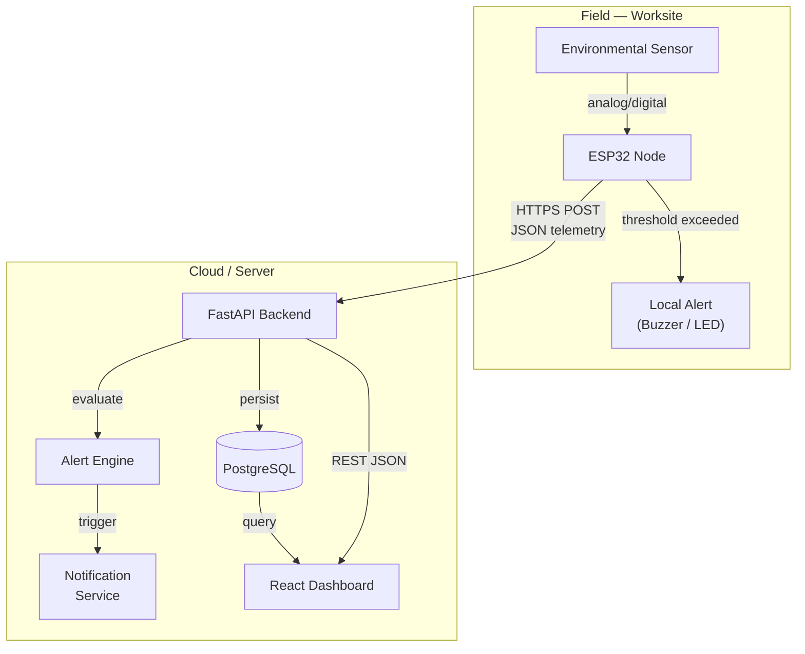
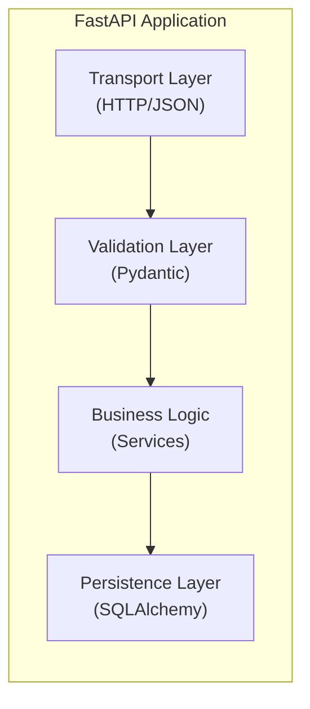
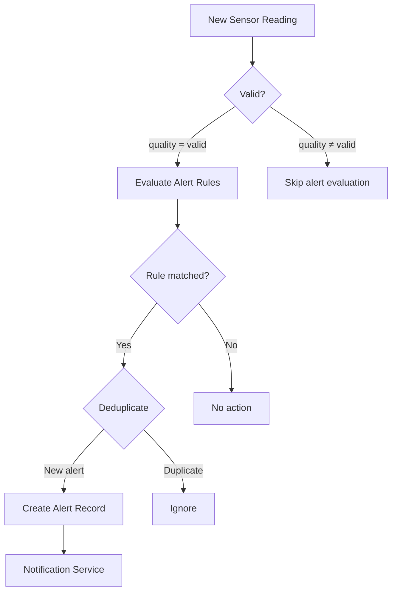
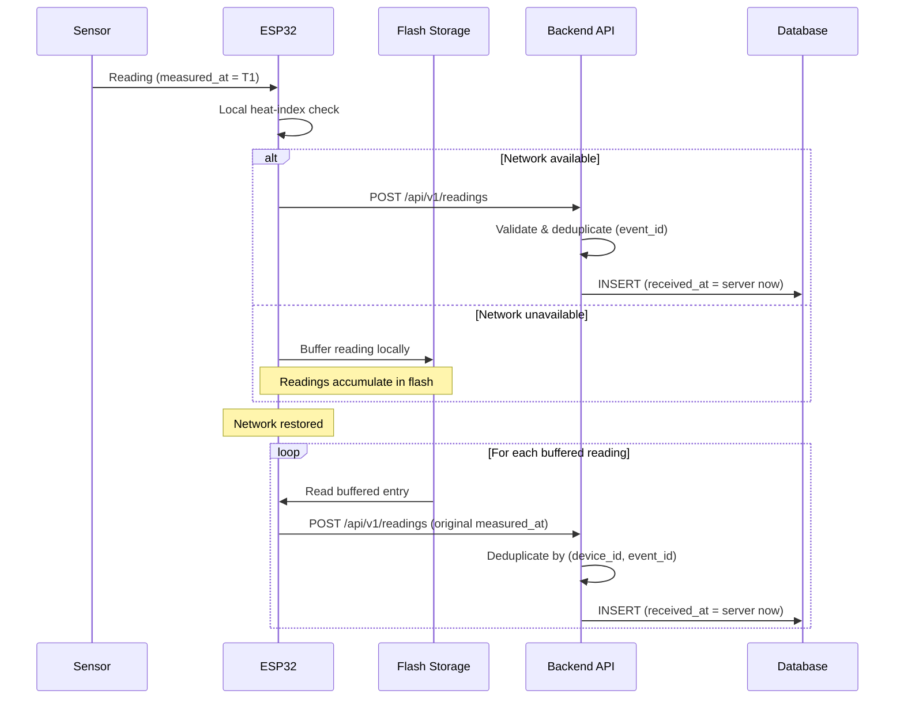
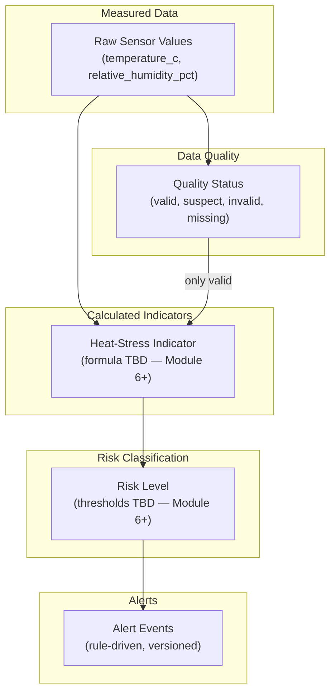

# HeatShield Bharat — System Architecture

> **Status:** Proposed (Module 2). Subject to refinement as implementation
> progresses and hardware is confirmed.
>
> This document refines and extends the high-level overview from Module 1
> ([overview.md](overview.md)). Both documents will be maintained; this one
> provides the detailed component view.

---

## 1. System Context

HeatShield Bharat is a multi-layer IoT system deployed across one or more
**worksites**. Each worksite has one or more **ESP32 sensor nodes** that
monitor environmental conditions. Telemetry flows to a centralised backend
that persists data, evaluates alert rules, and serves a supervisor dashboard.

---

## 2. Component Responsibilities

### 2.1 Physical Sensors

- Measure temperature (°C) and relative humidity (%).
- Additional environmental parameters may be added after hardware confirmation.
- Connected to the ESP32 via I²C, SPI, or digital GPIO.
- **Hardware status:** Unconfirmed (see [ADR-008](../decisions/architecture-decisions.md)).

### 2.2 ESP32 Firmware

| Responsibility | Details |
|---|---|
| Sensor reading | Read sensors at configurable intervals |
| Local heat-index | Compute on-device for immediate alerting |
| Local alerts | Trigger buzzer/LED when thresholds are exceeded — works offline |
| Telemetry transmission | Format JSON, POST to `/api/v1/readings` via HTTPS |
| Device identity | Include a stable `device_code` and per-event `event_id` |
| Offline buffering | Store readings in flash (SPIFFS/LittleFS) when network is down |
| Retry & upload | Upload buffered readings chronologically on reconnection |
| Power management | Deep-sleep modes for battery-powered deployment |
| Firmware version | Report `firmware_version` in each telemetry payload |

### 2.3 FastAPI Backend

| Layer | Responsibility |
|---|---|
| **Transport** | Accept HTTP requests, route to handlers, return JSON responses |
| **Validation** | Pydantic schemas validate request bodies, query params, path params |
| **Business Logic** | Device registration, reading ingestion, deduplication, alert rule evaluation, acknowledgement |
| **Persistence** | SQLAlchemy models ↔ PostgreSQL via connection pool |

Key design rules:
- **No business logic in route handlers** — handlers delegate to service functions.
- **No raw SQL in services** — use SQLAlchemy ORM (except documented performance-critical queries).
- **All timestamps stored in UTC** — see [ADR-009](../decisions/architecture-decisions.md).
- **Simulated data explicitly labelled** — `source_mode` field distinguishes `hardware` from `simulated`.

### 2.4 PostgreSQL Database

- Primary persistence for all entities (see [database-design.md](database-design.md)).
- Managed through SQLAlchemy models and Alembic migrations.
- All `TIMESTAMP` columns use `TIMESTAMP WITH TIME ZONE` and store UTC values.
- Indexes optimised for device + time-range queries.
- Soft deletion (deactivation) preferred over hard deletion for historical integrity.

### 2.5 Alert Engine

The alert engine is a backend service (not a separate process) that evaluates
configured alert rules against incoming sensor readings.

- Only **valid** readings trigger alert evaluation.
- Each alert references the rule and rule version that produced it.
- Deduplication prevents repeated alerts for sustained threshold exceedance.
- Alert lifecycle: `triggered` → `acknowledged` → `resolved` or `expired`.

### 2.6 React Dashboard

- Single-page application (SPA) built with Vite.
- Communicates exclusively through the versioned REST API (`/api/v1/...`).
- Displays current conditions, historical trends, active alerts, device status.
- Converts UTC timestamps to local display time in the browser.
- Does not perform alert evaluation or risk calculation — those are backend responsibilities.

---

## 3. Local Alerts vs. Server-Side Alerts

| Aspect | Local Alert (Firmware) | Server-Side Alert (Backend) |
|---|---|---|
| Trigger source | Single reading exceeds on-device threshold | Configurable rules evaluated by alert engine |
| Latency | Immediate (milliseconds) | Depends on telemetry interval |
| Output | Buzzer, LED | Dashboard notification, email, webhook (TBD) |
| Network required | No | Yes |
| Configurability | Flash-stored or hardcoded thresholds | Database-stored rules, editable via API |
| Rule versioning | Firmware version serves as implicit version | Explicit `rule_version` column |

Both mechanisms are complementary: local alerts ensure immediate safety even
when offline, while server-side alerts enable richer multi-reading analysis
and remote notification.

---

## 4. Offline Operation & Data Integrity

Key invariants:
- `measured_at` reflects the device clock at the time of measurement (nullable if device clock is unreliable).
- `received_at` is always set by the server on receipt — never trust the device for this.
- `event_id` is unique per device, enabling idempotent ingestion and safe retries.
- Buffered readings are uploaded in chronological order.
- The backend never modifies `measured_at`; it records the value as provided.

---

## 5. Device Identity & Authentication

- Each device has a stable, non-secret `device_code` (e.g., `HS-WS01-D001`).
- Device authentication mechanism is **TBD** (API key header, JWT, or mutual TLS).
- Authentication secrets are **never** stored as plain-text device metadata.
- The `device_code` is used for telemetry attribution; the auth token is used for access control.

---

## 6. Separation of Concerns

- **Raw measurements** are stored as-is; they are never retroactively "corrected."
- **Quality status** is assigned during ingestion validation.
- **Calculated indicators** (heat-index, WBGT approximation, etc.) are derived values — the formula, version, and limitations must be documented.
- **Risk classification** maps an indicator value to a severity level using versioned thresholds.
- **Alert events** are the actionable output of risk classification, referencing the rule that produced them.

Temperature and humidity alone **do not constitute a WBGT measurement**.
Any indicator must identify its formula, units, assumptions, input requirements,
and limitations. See [ADR-014](../decisions/architecture-decisions.md).

---

## 7. Security Considerations (Planned)

| Concern | Approach |
|---|---|
| Device → backend | HTTPS + device auth token (mechanism TBD) |
| Dashboard → backend | HTTPS + user auth (mechanism TBD) |
| Secrets management | `.env` files, never committed; secrets never in plain-text metadata |
| Password storage | Bcrypt or Argon2 hash (never plaintext) |
| Audit logging | Security-relevant actions recorded with actor, action, target, timestamp |
| Data minimisation | No unnecessary personal or physiological data collected |

---

## 8. Pending Decisions

| Decision | Blocked By |
|---|---|
| ESP32 board and sensor models | Hardware purchase |
| Device authentication mechanism | Security review |
| User authentication mechanism | Security review |
| Notification channels (email, SMS, webhook) | Requirements finalisation |
| Heat-risk formula and thresholds | Literature review, sensor confirmation |
| Time-series partitioning strategy | Volume projections after initial deployment |

---

## 9. Cross-References

- [Architecture Overview (Module 1)](overview.md)
- [Data Flow Specification](data-flow.md)
- [Database Design](database-design.md)
- [API Contracts](api-contracts.md)
- [Architecture Decisions](../decisions/architecture-decisions.md)
- [Firmware Plans](../../firmware/README.md)
